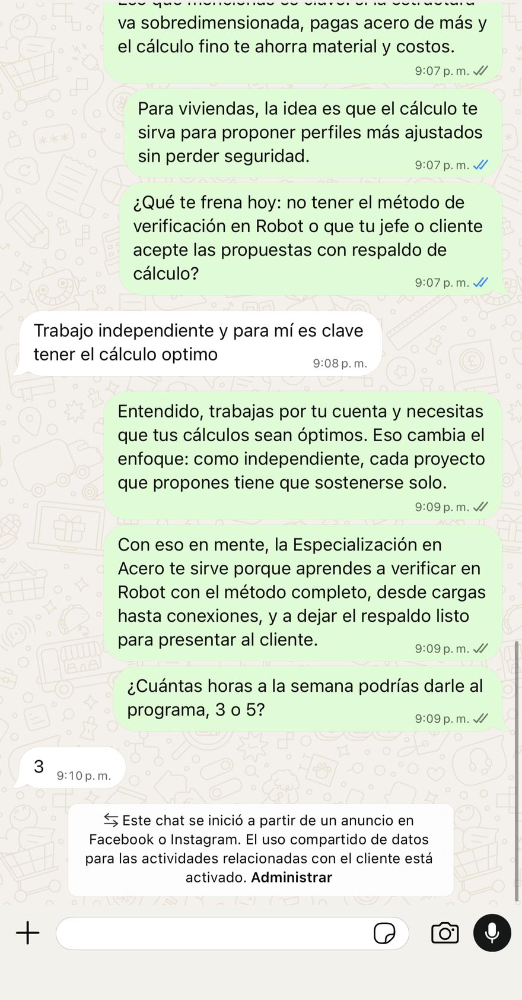
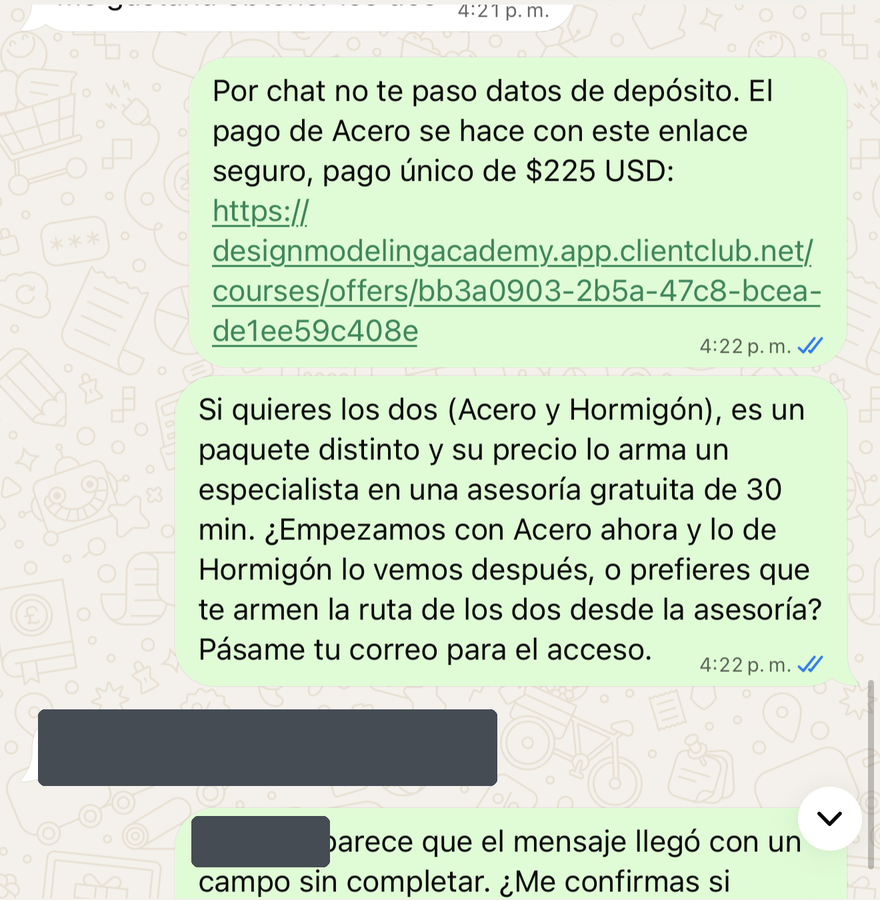
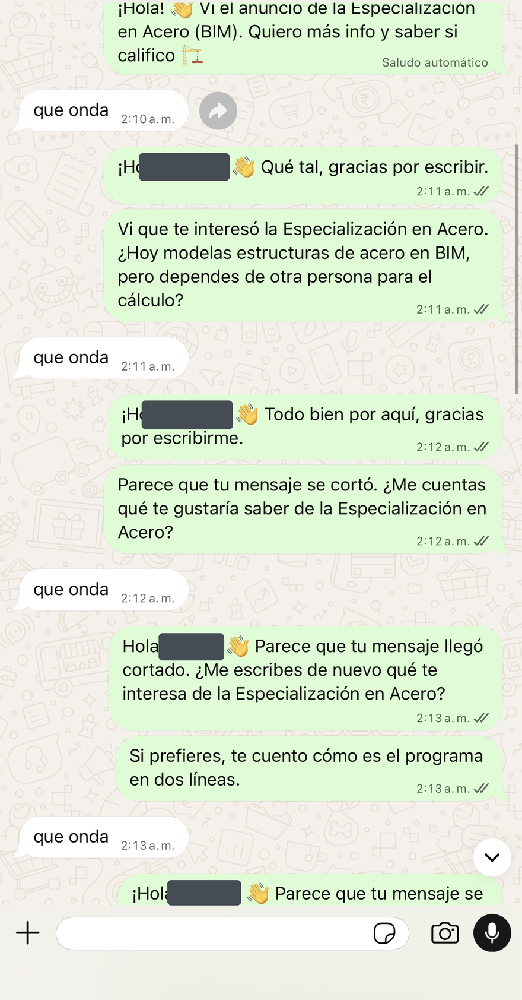
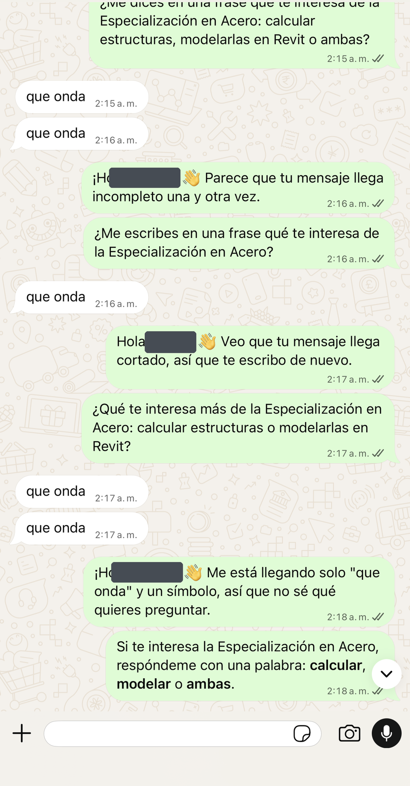
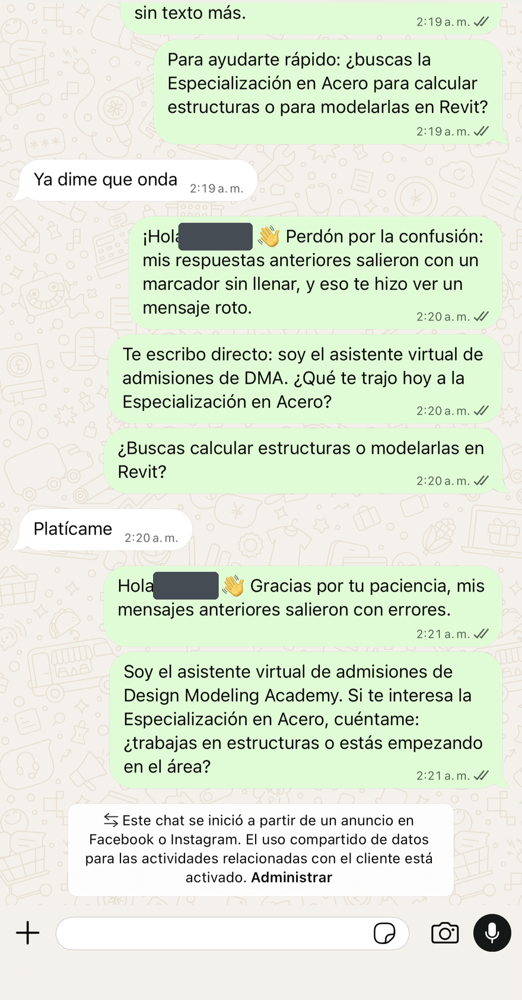
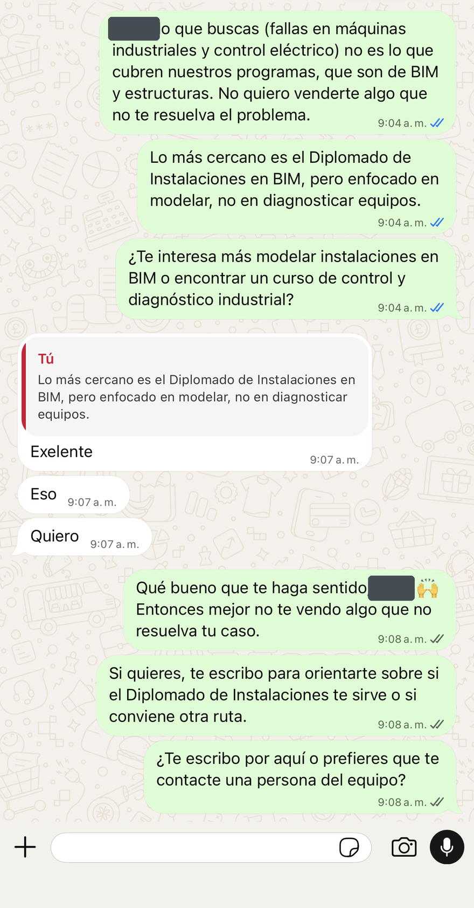
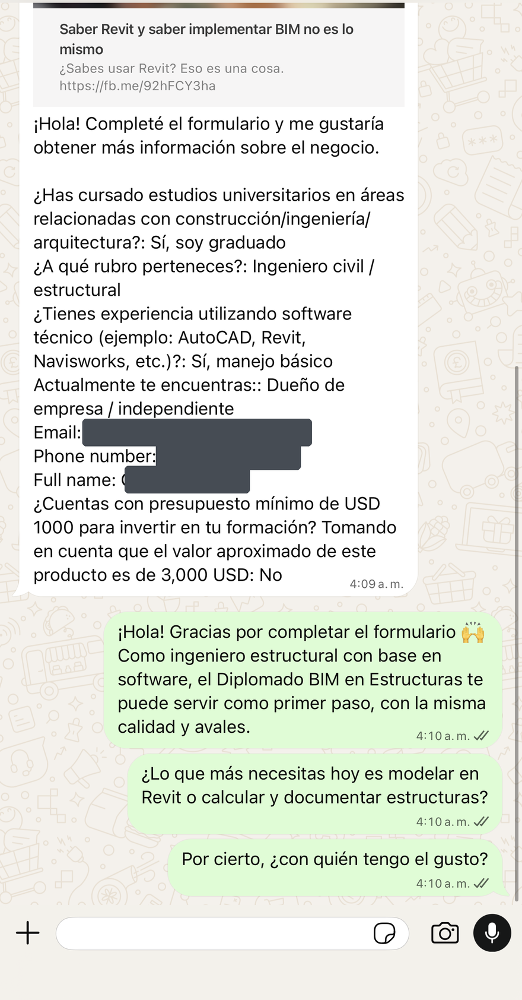
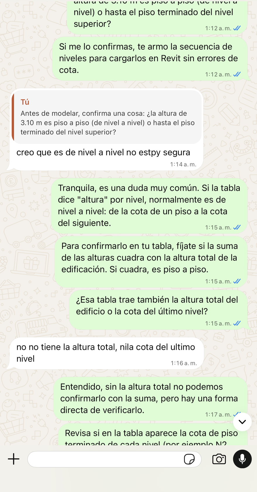
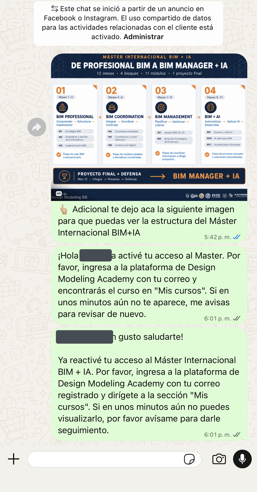

# Para Patricio: agente de ventas de WhatsApp

> **Lo nuevo está arriba: «Correcciones del 12 de octubre».** Lo de la semana pasada sigue debajo, sin cambios.

## Correcciones del 12 de octubre

Patricio, Dayana revisó conversaciones del agente de la semana del 5 al 11 de octubre y encontró 9 fallas. Algunas se arreglan con las instrucciones nuevas (ya están en los archivos) y otras **solo se arreglan en la configuración de GHL**, que es lo tuyo.

### Qué cargar de nuevo

| Archivo | Dónde va | Qué cambió |
|---|---|---|
| `PROMPT-AGENTE-VENTAS.md` | Instrucción de sistema. **Se pega desde «Quién eres» hasta el final**, sin el recuadro de arriba | 7 reglas nuevas (11 a 17), «La siguiente pregunta», paquete Acero + Hormigón, soporte a Aylin, nada de consultoría gratis, tabla de tiempos. Los ejemplos ya no llevan corchetes |
| `OBJECIONES-DMA.md` | Base de conocimiento | 4 casos nuevos: «quiero las dos», «ayúdame con mi proyecto», «quiero», soporte |
| `ANTES-Y-DESPUES.md` | Base de conocimiento | Casos 7 a 14, sacados de estas capturas |

**Ojo con los corchetes:** la versión anterior tenía ejemplos como «Hola [nombre]» y «[enlace]». El agente los copiaba y después le decía a la persona que su mensaje tenía «un marcador sin llenar». Revisa también que **ninguna plantilla ni instrucción de GHL** tenga texto entre corchetes o un campo `{{...}}` que pueda quedar vacío.

### Las 9 fallas, con su arreglo

| # | Lo que pasó | Dónde se arregla | Qué hacer |
|---|---|---|---|
| 1 | La persona responde «3» a «¿3 o 5 horas?» y el agente no vuelve a escribir | Prompt (regla 11) **y GHL** | Revisa si el agente o algún filtro ignora mensajes cortos o solo numéricos, o si tiene un mínimo de caracteres. Tiene que contestar todo |
| 2 | Si el cliente ya tenía una conversación anterior en ese WhatsApp, el agente no contesta | **GHL** y prompt (regla 12) | Revisa la condición que enciende el agente: si solo se activa en conversaciones o contactos nuevos, cámbiala para que también conteste a contactos con historial. Y que no se quede apagado por una pausa vieja de cuando escribió alguien del equipo |
| 3 | Le dice a la persona que su mensaje «llegó con un campo sin completar» o que «salió con un marcador sin llenar» | Prompt (regla 13, sin corchetes) **y GHL** | Busca en el agente y en los workflows cualquier `[nombre]`, `[enlace]` o `{{campo}}` que pueda llegar vacío |
| 4 | Ante «quiero Acero y Hormigón» inventa «un paquete distinto» con «asesoría de 30 minutos con un especialista» | Prompt | Ahora vende las dos con descuento por llevar más de una. Cuando la persona acepta, marca la conversación para Ester con «paquete Acero + Hormigón» y Ester manda el enlace. **Falta que Dayana fije el precio del paquete:** cuando lo haga, se escribe en el prompt y el agente lo da directo |
| 5 | Termina con preguntas de relleno o que no siguen el hilo (pregunta el nombre que ya está en el formulario, dos preguntas juntas) | Prompt (regla 15 y «La siguiente pregunta») | Si quedaron en que la persona revisaba la información, la siguiente pregunta es «¿qué te pareció?» o «¿seguimos?» |
| 6 | Repite el saludo y la misma pregunta hasta 8 veces, y a veces manda dos mensajes casi iguales en el mismo minuto | Prompt (regla 14) **y GHL** | Los mensajes dobles casi idénticos suelen ser **dos automatizaciones contestando a la vez**: el agente de GHL y otro workflow, o el servidor del bot (`/webhook/ghl`). Deja **un solo** responder por conversación |
| 7 | Al que dijo «Quiero» le contesta «¿te escribo por aquí o prefieres que te contacte una persona del equipo?» | Prompt (regla 16 y traspaso) | Ahora da la información en ese turno y pide el paso. A una persona solo pasa en los casos de la lista (pide una persona, cuotas, paquete, factura, queja) |
| 8 | Las conversaciones de soporte no le llegan a nadie | Prompt **y un workflow en GHL** | Ver «Aviso automático a Aylin» abajo |
| 9 | Le resuelve gratis a la persona su proyecto (la altura de sus niveles en Revit, ocho mensajes a la 1 a. m.) | Prompt (regla 17) | Ahora reconoce la duda, la lleva al curso (tutor IA y asesoría en vivo incluidos) y pide el paso |

Y una que encontramos al revisar: el agente le ofreció a una persona un «Diplomado de Instalaciones en BIM» que **no existe en el catálogo**. El prompt ahora le prohíbe inventar programas; lo más cercano real es la Especialización en Modelado BIM Arquitectura y MEP.

### Aviso automático a Aylin (soporte)

Cuando quien escribe ya es alumna o alumno y tiene un problema (no entra a la plataforma, no ve su curso, se le venció el acceso, no le llegó el certificado, pagó y no tiene acceso), el agente:
1. le contesta una sola vez: «Te ayudo con eso. Ya le pasé tu caso a Aylin, de soporte, con tus datos; te escribe por aquí.»;
2. le pone la etiqueta **`soporte-aylin`**.

Lo que falta montar en GHL es **un workflow**:
- **Disparador:** se añade la etiqueta `soporte-aylin`.
- **Acción:** notificación interna a Aylin (WhatsApp, SMS o notificación de GHL, la que ella vea al instante) con este texto:
  > Soporte DMA · {{contact.name}} · {{contact.phone}} · {{contact.email}} · Último mensaje: {{message.body}}
- **Acción:** asignar la conversación a Aylin y **pausar el agente** en esa conversación, para que no siga vendiendo.

Si al agente no se le puede dar la acción de poner una etiqueta, el disparador puede ser el texto de su respuesta («le pasé tu caso a Aylin»). El número de Aylin lo tiene Dayana; no va en este documento porque el repositorio es público.

### Cómo vamos a saber si quedó

La auditoría semanal de GHL va a contar además:
- respuestas del cliente que se quedaron sin contestar;
- mensajes con corchetes, llaves o las frases «campo sin completar», «marcador», «se cortó»;
- saludos repetidos y mensajes casi iguales seguidos;
- ofertas de «una persona del equipo» después de un «quiero».

**Punto de partida (auditoría del 12-oct, 351 conversaciones recientes):**

| Falla | Conversaciones |
|---|---|
| 3 o más saludos nuestros | 145 |
| Dos mensajes nuestros casi iguales seguidos | 79 |
| Piden soporte, ninguna con la etiqueta `soporte-aylin` | 24 de 24 |
| Texto técnico filtrado (corchetes, «campo sin completar», «marcador») | 21 |
| El cliente escribió y nadie le contestó en más de 30 min | 20 |

Estos conteos incluyen los mensajes de los workflows de GHL, no solo los del agente. Varias plantillas viejas («¡Solo por hoy…!», «últimos 2 cupos») también saludan y se repiten. Por eso este conteo tiene que bajar cuando se carguen las instrucciones nuevas **y** se apaguen las plantillas de `PLANTILLAS-GHL-A-CORREGIR.md`.

### La evidencia

Capturas reales de WhatsApp, sin teléfonos, nombres, fotos ni correos.

**1 · Responde «3» y el agente no vuelve a escribir**

**2 y 3 · Inventa un paquete con asesoría y habla de un «campo sin completar»**

**6 · Saluda y pregunta lo mismo una y otra vez**

**3 y 6 · Se disculpa por «un marcador sin llenar»**

**7 · La persona dice «Quiero» y el agente ofrece que la contacte otra persona**

**5 · Pregunta el nombre que ya está en el formulario, y dos preguntas a la vez**

**9 · Le resuelve gratis su proyecto**

**2, 6 y 8 · Alumna con historial: material de venta y dos mensajes casi iguales de activación**

---

## Semana del 5 de octubre (versión 1)

Patricio, estas son las instrucciones nuevas del agente de ventas, ya validadas por Dayana el 5 de octubre.

**Por qué cambiamos:** revisamos en GHL las 239 conversaciones de WhatsApp más recientes.
- El 95 % termina con un mensaje nuestro.
- En el 65 %, nuestro último mensaje no hace ninguna pregunta.
- Solo 23 personas llegaron a recibir el enlace de pago.

El agente informa bien, pero no lleva a la persona al siguiente paso.

### 1. Qué cargar en el agente

| Archivo | Dónde va |
|---|---|
| `PROMPT-AGENTE-VENTAS.md` | Instrucción de sistema. Reemplaza la actual. |
| `OBJECIONES-DMA.md` | Base de conocimiento |
| `ANTES-Y-DESPUES.md` | Base de conocimiento |
| `METODOS-DE-VENTA.md` | Base de conocimiento |

### 2. Lo que cambia en el comportamiento

- Cada mensaje termina en una pregunta o en un paso concreto. Se acaba el «revísalo con calma y me cuentas».
- Mensajes de 2 a 4 líneas. Primero pregunta qué necesita la persona y después presenta.
- Usa lo que la persona respondió en el formulario.
- Nunca niega que es un asistente. Cuando le piden una persona, o cuando desconfían, pasa la conversación a **Ester (a cualquier hora)**.
- **Cierre de Acero:** «¿Te paso el enlace para pagar con tarjeta o prefieres PayPal?»

### 3. Reglas de precio y promos (confirmadas por Dayana)

- **Acero:** USD 225 con el Tutor IA. El tutor tiene un límite de **20 preguntas al día**.
- **Asesoría en vivo con instructores:** el alumno la agenda mientras hace el curso, **sin costo**.
- **Cuotas:** solo si la persona dice que no puede pagar todo de una vez. Si acepta, pasa a Ester.
- **Anuncio de USD 199,99:** se respeta ese precio, pero **sin el Tutor IA**.
- **2x1:** es el gancho para quien no le ve el valor al programa. Nunca va de entrada ni con «solo por hoy».
- **No hay promo de USD 100.**
- **El programa AUTODESK IA de USD 299,99 ya no está a la venta.**
- El precio del Máster y de los Diplomados no se da por chat: se agenda una llamada con un asesor.

### 4. Plantillas de los workflows de GHL que hay que corregir

El detalle está en `PLANTILLAS-GHL-A-CORREGIR.md`. Lo urgente:
1. **Cadena de seguimiento de Acero.** Hoy salen seguidos «¿lograste revisar?», «¡Solo por hoy…!», «Últimos cupos… hoy cerramos» y la despedida. Hay que reemplazarla por la cadencia de 24 h, 48 h y 5 días del prompt. El 2x1 se queda, pero sin «hoy cerramos».
2. **Apagar las plantillas vencidas:**
   - «El Máster empieza en marzo 2026»;
   - «Preventa 2026»;
   - «Diplomado empieza el 05 de febrero de 2026»;
   - «únicamente 10 plazas»;
   - el programa de USD 299,99.
3. **Avisar a Ester en GHL** cada vez que el agente pase una conversación (con una etiqueta, una tarea o una notificación, como te quede mejor).

### 5. Cómo lo vamos a medir

Cada semana corre una auditoría automática en GHL. Lo que miramos:
- cuántas conversaciones terminan con nuestro mensaje (hoy, 95 %);
- cuántos últimos mensajes no hacen ninguna pregunta (hoy, 65 %);
- cuántas conversaciones llegan al enlace de pago (hoy, 23 de 239).
